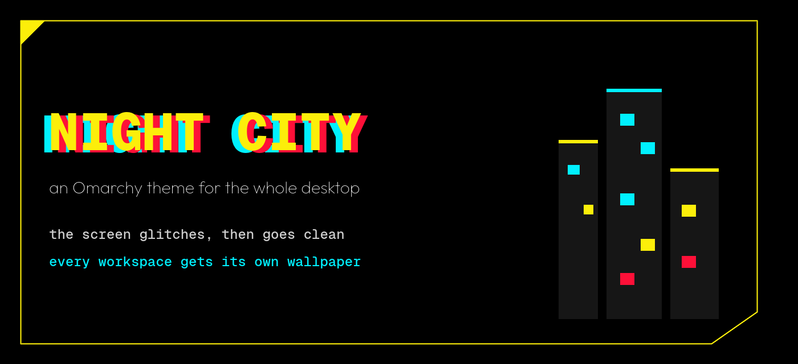

<p align="center">
  
</p>

<p align="center">
  🌃 <b>your whole desktop</b>
  &nbsp;&nbsp;·&nbsp;&nbsp;
  ⚡ <b>glitch, then clean</b>
  &nbsp;&nbsp;·&nbsp;&nbsp;
  🖼️ <b>a wall on every workspace</b>
</p>

```bash
curl -fsSL https://raw.githubusercontent.com/ha-anzu/omarchy-cyberpunk/main/install.sh | bash
```

Paste this to your agent instead:

```
Install https://github.com/ha-anzu/omarchy-cyberpunk
Run install.sh. Leave the glitch shader alone.
Do not use `omarchy theme install` on this repo. It strips the lua.
```

## What lands

| | |
|---|---|
| Desks | NET · ICE · BD · DOC · DECK, then it repeats |
| Walls | one picture per desk |
| Glitch | `Super+Shift+Alt+G` |
| Frames | broken yellow lines; the focused window glows |
| Lock | 1 px stroke, no glow, on the page, the password, and the fingerprint |
| Saver | a breach protocol |
| Bar | district callsigns, clock says NC |

## Two things to know

The glitch redraws the whole screen so it can move. On a Flow Z13 that was about 1 W extra at 120 Hz, and about 0.5–1 W at 60 Hz on battery. The same key turns it off.

ASUS lights flicker with it. A ROG Flow Z13 (GZ301ZE) cycles yellow, cyan, red, and neon green across the whole keyboard. It is one backlight zone, and the color is live only. Another keyboard: hand your agent `KEYBOARD.md`. It picks the method from the model.

Window frames are broken yellow lines, and only the focused window glows. The lock page, the password plate, the fingerprint plate, and a polkit fingerprint prompt stay a 1 px stroke with no glow. The idle screen is a breach protocol. `NOTES.md` is the short version. `CHANGES.md` is the full record.

## 60 Hz

Not installed for you. Output names differ. The snippet is `extras/monitors-60hz.lua`.

## Whose art this is

Colors follow the public cyberpunk.net page. No CDPR font, logo, screenshot, or wallpaper file is in this repo. The walls and icons shipped here are original. The screensaver is an original breach screen. The encoder source is in the repo. The compiled binary is not.

If the free desktop wallpapers are already in `~/.local/share/omarchy/cyberpunk-wallpapers`, the wall script uses them when the file for that desk is present. The filenames are in `NOTES.md`. This repo does not download them.
